  
   
  
  
  
  

<table align="center"><tr>
<td valign="top" width="50%">

 Coolkid 1: what is wumble. what is this. how do i wumble.

</td>
<td valign="top" width="50%">

<a href="https://github.com/1">@moot1</a> &nbsp;
<a href="https://github.com/2">@moot2</a> &nbsp;
<a href="https://github.com/3">@moot3</a>

</td>
</tr></table>

every drawing here was offered to wumble by friends &amp; strangers, you should draw for me :3 · <a href="https://wumblebumble.straw.page">wumblebumble.straw.page</a>

